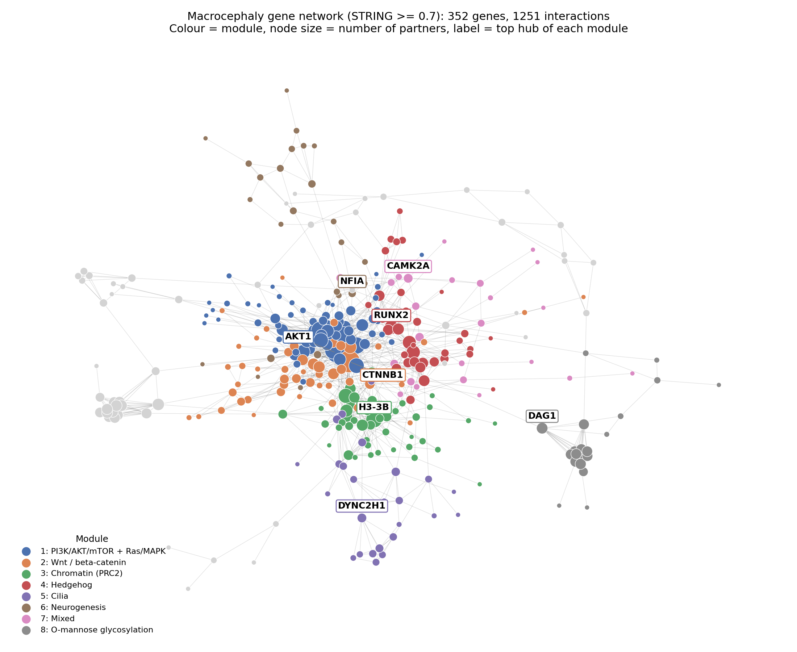
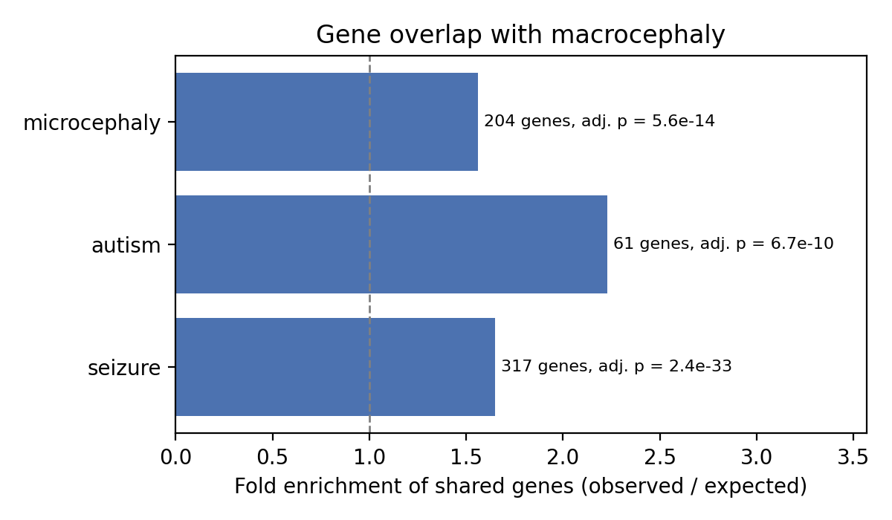
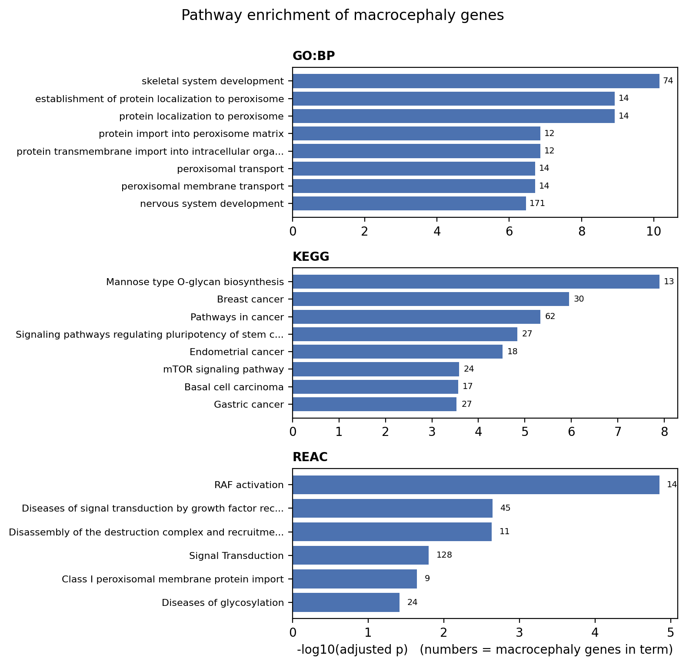

# Macrocephaly gene landscape

Which biological pathways connect the genes behind macrocephaly, and how much of its genetics is shared with microcephaly, autism and seizures?

This project rebuilds and extends my B.Sc. dissertation (*Unraveling the Genetic Landscape of Macrocephaly*, Sathyabama Institute of Science and Technology, 2024). The original work explored DisGeNET exports descriptively. This version uses openly available data so the whole analysis can be rerun from scratch, and it adds the statistical tests the first version was missing: hypergeometric overlap tests, pathway enrichment against a matched background, and a protein interaction network.

## Key findings

**1. Macrocephaly genes are split between two routes to a large head.**
Pathway enrichment and the interaction network agree. One group of genes drives brain overgrowth through growth signalling (PI3K/AKT/mTOR, Ras/MAPK, Hedgehog, Wnt). A second, separate group causes head enlargement through metabolic and structural disorders: peroxisome biogenesis (PEX genes), O-mannose glycosylation (POMT1, FKRP and others) and lysosomal storage (IDS, GUSB, ARSB). This mirrors the clinical distinction between megalencephaly and other causes of macrocephaly.

**2. The genes form a tightly connected network.**
STRING reports 1,268 high-confidence interactions among the macrocephaly genes, against 565 expected for a random gene set of the same size (PPI enrichment p < 1e-16). The network splits into clear modules:

| Module | Genes | Top hubs | Main pathway |
|---|---|---|---|
| 1 | 72 | AKT1, PIK3CA, KRAS, PTEN, HRAS | PI3K/AKT/mTOR and Ras/MAPK |
| 2 | 50 | CTNNB1, SMAD4, AXIN1, APC | Wnt / β-catenin |
| 3 | 45 | EZH2, SUZ12, EED, H3-3B | Chromatin regulation (PRC2) |
| 4 | 37 | SHH, IHH, SMO, RUNX2 | Hedgehog |
| 5 | 26 | DYNC2H1, OFD1, IFT80 | Primary cilia |
| 8 | 21 | DAG1, POMT1, POMGNT1 | O-mannose glycosylation |
| 9 | 16 | PEX5, PEX10, PEX12 | Peroxisome import |
| 11 | 11 | IDS, GUSB, ARSB | Lysosomal storage |

PI3K and Ras/MAPK genes fall into a single module rather than two, consistent with the known crosstalk between these pathways. The cilia module sits next to Hedgehog, which is expected since Hedgehog signalling is transduced through the primary cilium.



**3. Macrocephaly shares more genes with related phenotypes than chance predicts.**

| Comparison | Shared genes | Expected | Fold enrichment | Adjusted p |
|---|---|---|---|---|
| Macrocephaly vs autism | 61 | 27.4 | 2.23 | 6.7e-10 |
| Macrocephaly vs seizure | 317 | 191.8 | 1.65 | 2.4e-33 |
| Macrocephaly vs microcephaly | 204 | 131.2 | 1.56 | 5.6e-14 |

Autism shows the strongest enrichment. The seizure comparison has the smallest p-value only because the seizure gene set is very large, which is why fold enrichment is the fairer comparison. Macrocephaly and microcephaly, opposite head-size phenotypes, still share 1.6 times more genes than expected, suggesting the same growth pathways can push brain size in either direction. Thirty-seven genes are linked to all four phenotypes, including CHD8, MECP2, SHANK3 and UBE3A.

<p float="left">
  
  
</p>

## Methods

| Step | Notebook | What it does |
|---|---|---|
| 1 | `01_gene_sets.ipynb` | Builds gene sets from the Human Phenotype Ontology (HPO): macrocephaly (HP:0000256), microcephaly (HP:0000252), autism (HP:0000717) and seizure (HP:0001250), each including all sub-terms. Background = all 5,277 HPO-annotated genes. |
| 2 | `02_overlap_tests.ipynb` | Hypergeometric test for each pairwise overlap, Benjamini–Hochberg correction, Jaccard similarity. |
| 3 | `03_enrichment.ipynb` | g:Profiler enrichment (GO biological process, KEGG, Reactome) with the HPO-annotated genes as a custom background and g:SCS correction. |
| 4 | `04_network.ipynb` | STRING interactions at combined score ≥ 0.7, PPI enrichment test, degree and betweenness centrality, Louvain modules (seed 42). Exports a GraphML file for Cytoscape. |

The background choice matters. Because the gene sets come from HPO, comparing them against the whole genome would make "disease genes in general" look enriched. Using HPO-annotated genes as the background asks what is specific to macrocephaly among disease genes.

## How to run

The notebooks were written for Google Colab and run in order. Each one downloads its own data, and each saves a zip of its results that the next notebook reads.

1. Open `notebooks/01_gene_sets.ipynb` in Colab and run all cells.
2. Upload the zip it produces to the next notebook's session, then run that notebook. Repeat through notebook 04.

To run locally instead, install the requirements and skip the Colab upload and download cells:

```bash
pip install -r requirements.txt
```

The databases are updated regularly, so gene counts and p-values will shift slightly between runs. The run dates are saved in `results/*_run_info.txt` and `results/gene_set_summary.csv` (this analysis: October 2026).

## Repository layout

```
notebooks/   the four analysis notebooks
results/     gene sets, test results, enrichment tables, network files
figures/     figures used in this README
```

## Limitations

- HPO annotations come from published case reports, so well-studied genes collect more phenotype annotations. This annotation bias can inflate overlaps between phenotypes. Using HPO-annotated genes as the background reduces the effect but does not remove it.
- STRING combines several evidence types, including text mining and co-expression, so a high score does not always mean a direct physical interaction. Hub status partly reflects how much a protein has been studied.
- Overlaps and modules describe shared reported genetics. They point to candidate shared mechanisms; they do not prove them.
- Running enrichment on the 37 genes shared by all four phenotypes gave no significant terms, which is expected for such a small set.

## Data sources

- Gargano MA *et al.* The Human Phenotype Ontology in 2024: phenotypes around the world. *Nucleic Acids Research* 52, D1333–D1346 (2024).
- Kolberg L *et al.* g:Profiler: interoperable web service for functional enrichment analysis and gene identifier mapping (2023 update). *Nucleic Acids Research* 51, W207–W212 (2023).
- Szklarczyk D *et al.* The STRING database in 2023: protein–protein association networks and functional enrichment analyses for any sequenced genome of interest. *Nucleic Acids Research* 51, D638–D646 (2023).
- Blondel VD *et al.* Fast unfolding of communities in large networks. *Journal of Statistical Mechanics* P10008 (2008).

## Author

**Hafsa Fathima Khajamainudeen**
M.Sc. Bioinformatics & Data Science, Sathyabama Institute of Science and Technology
[Google Scholar](https://scholar.google.com/citations?hl=en&user=Iz5aXRUAAAAJ) · hafsafathima2004@gmail.com
