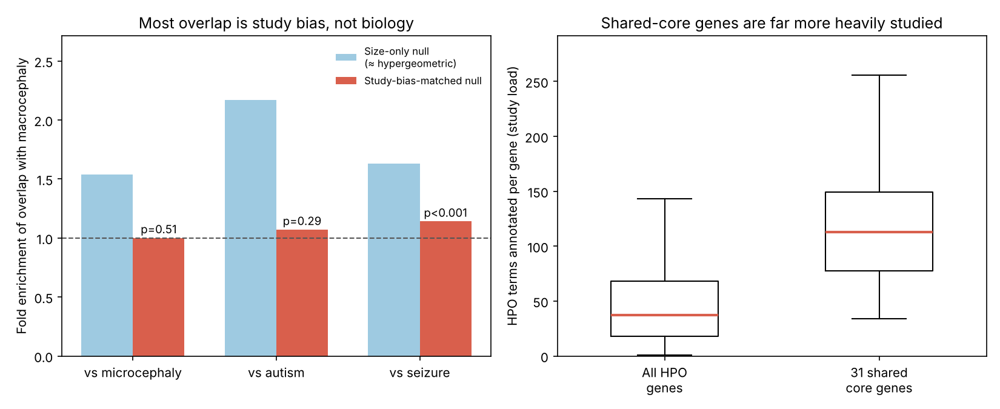
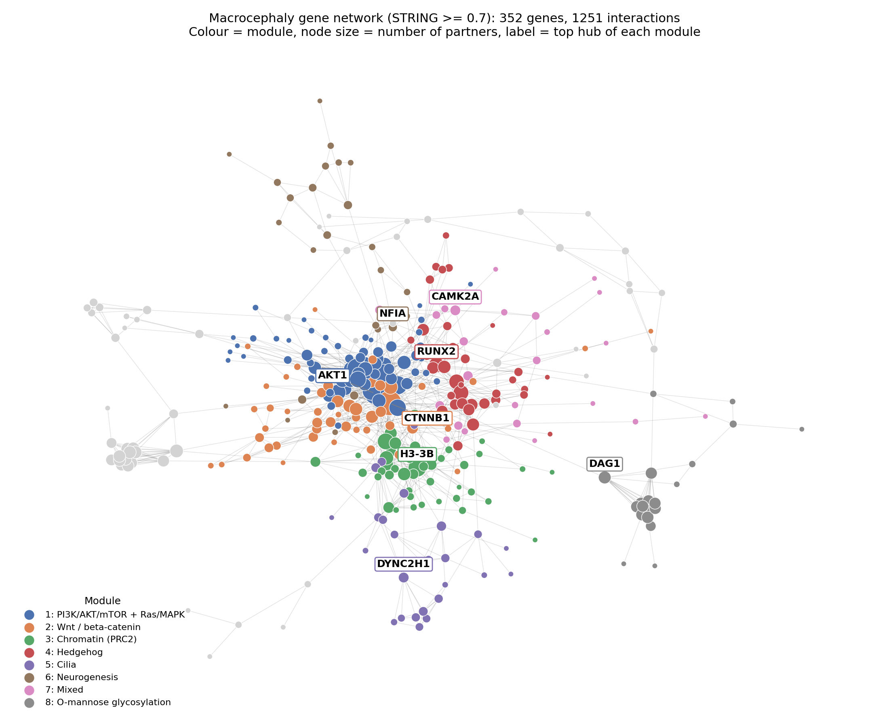

# Macrocephaly gene landscape

When you ask how much macrocephaly shares its genetics with microcephaly, autism and seizures, most of the answer turns out to be an artifact of how much each gene has been studied — not biology.

This project rebuilds and extends my B.Sc. dissertation (*Unraveling the Genetic Landscape of Macrocephaly*, Sathyabama Institute of Science and Technology, 2024). The original work explored DisGeNET exports descriptively. This version uses openly available data so the whole analysis can be rerun from scratch, adds the statistical tests the first version was missing (hypergeometric overlap, pathway enrichment against a matched background, a protein interaction network), and then does the step those tests leave out: it asks whether the overlaps survive once the uneven study of genes is controlled for. Most of them do not.

## The main result

Gene sets built from the Human Phenotype Ontology (HPO) are shaped by a bias that is easy to forget: a handful of genes, such as MECP2, SHANK3 and CHD8, have been studied so heavily that they are annotated to hundreds of phenotypes, while most genes have only a few annotations. Any two phenotype sets will therefore share these heavily studied genes regardless of whether they share real biology. A standard hypergeometric (or size-matched) test does not account for this, because it treats every gene as equally likely to appear.

To separate signal from study bias, each overlap was retested against a **study-bias-matched null**: instead of drawing random genes, the null draws gene sets matched to the real macrocephaly genes' annotation load (number of HPO terms per gene, from PyHPO), 10,000 times. The question it answers is sharper — *is the overlap larger than you would get from an equally well-studied random gene set of the same size?*

| Overlap with macrocephaly | Observed | Size-only null (≈ hypergeometric) | **Study-bias-matched null** | Survives bias control? |
|---|---|---|---|---|
| Microcephaly | 192 | 1.54× (p < 1e-4) | **1.00×, p = 0.51** | No |
| Autism | 55 | 2.17× (p < 1e-4) | **1.07×, p = 0.29** | No |
| Seizure | 301 | 1.63× (p < 1e-4) | **1.14×, p < 1e-4** | Yes, but small |



The size-only null reproduces the naive hypergeometric result (folds of 1.54–2.17, all highly significant). Under the bias-matched null, two of the three overlaps disappear. The macrocephaly–microcephaly overlap falls to exactly what study bias predicts (1.00×), and the macrocephaly–autism overlap — the strongest in the naive test — drops to a non-significant 1.07×. Only the macrocephaly–seizure overlap survives, and even then the real excess is modest (1.14×), far smaller than the naive 1.63× suggested.

The genes linked to all four phenotypes tell the same story. Thirty-seven genes are shared across the full sets (31 of them have annotation-load data and could be tested). They look striking (2.16× more than a size-only null expects), but they are a study-bias artifact: against the bias-matched null the four-way overlap is 1.03× (p = 0.45), and these genes carry a median of 113 HPO annotations each, against a background median of 37. They are shared because they are famous, not because the four phenotypes converge on them specifically.

**The take-home: cross-phenotype gene overlaps read off HPO are largely a measurement artifact. A size-matched test is not enough; a study-bias-matched null is needed before an overlap can be called biological.**

## What macrocephaly's own genes look like

Separately from the overlap question, the macrocephaly gene set has a clear internal structure that is worth describing (this part is descriptive and consistent with known biology, not a novelty claim).

Pathway enrichment and the interaction network agree that macrocephaly genes fall into two broad routes to a large head. One group drives brain overgrowth through growth signalling (PI3K/AKT/mTOR, Ras/MAPK, Hedgehog, Wnt). A second group causes head enlargement through metabolic and structural disorders: peroxisome biogenesis (PEX genes), O-mannose glycosylation (POMT1, FKRP and others) and lysosomal storage (IDS, GUSB, ARSB). This mirrors the clinical distinction between megalencephaly and other causes of macrocephaly, and it was already known — the PI3K/AKT/mTOR link to macrocephaly and autism, for example, is established (Yeung et al., *Molecular Autism* 2017).

STRING reports 1,268 high-confidence interactions among the macrocephaly genes against 565 expected for a random set of the same size, and the network splits into coherent modules:

| Module | Genes | Top hubs | Main pathway |
|---|---|---|---|
| 1 | 72 | AKT1, PIK3CA, KRAS, PTEN, HRAS | PI3K/AKT/mTOR and Ras/MAPK |
| 2 | 50 | CTNNB1, SMAD4, AXIN1, APC | Wnt / β-catenin |
| 3 | 45 | EZH2, SUZ12, EED, H3-3B | Chromatin regulation (PRC2) |
| 4 | 37 | SHH, IHH, SMO, RUNX2 | Hedgehog |
| 5 | 26 | DYNC2H1, OFD1, IFT80 | Primary cilia |
| 8 | 21 | DAG1, POMT1, POMGNT1 | O-mannose glycosylation |
| 9 | 16 | PEX5, PEX10, PEX12 | Peroxisome import |
| 11 | 11 | IDS, GUSB, ARSB | Lysosomal storage |



One caveat applies here too: STRING scores combine evidence types including text mining, and both edge density and hub status partly reflect how much each protein has been studied. The module structure is a reasonable description of reported macrocephaly genetics; it is not offered as proof of mechanism.

## Methods

| Step | Notebook | What it does |
|---|---|---|
| 1 | `01_gene_sets.ipynb` | Builds gene sets from HPO: macrocephaly (HP:0000256), microcephaly (HP:0000252), autism (HP:0000717), seizure (HP:0001250), each including all sub-terms. Background = all HPO-annotated genes. |
| 2 | `02_overlap_tests.ipynb` | Hypergeometric test for each pairwise overlap, Benjamini–Hochberg correction, Jaccard similarity. |
| 3 | `03_enrichment.ipynb` | g:Profiler enrichment (GO BP, KEGG, Reactome) with HPO-annotated genes as a custom background and g:SCS correction. |
| 4 | `04_network.ipynb` | STRING interactions at combined score ≥ 0.7, PPI enrichment, degree and betweenness centrality, Louvain modules (seed 42). Exports GraphML for Cytoscape. |
| 5 | `05_bias_matched_null.ipynb` | Study-bias-matched permutation null for every overlap and for the four-way shared core, using per-gene HPO annotation load (PyHPO) as the study-bias covariate. 10,000 permutations, seed 42. |

The background choice in steps 2–3 (HPO-annotated genes rather than the whole genome) already removes the crudest form of bias — it asks what is specific to macrocephaly among disease genes. Step 5 removes the finer form: the uneven study of individual genes within that background.

## How to run

The notebooks were written for Google Colab and run in order; each downloads its own data and saves a zip the next notebook reads. To run locally, install the requirements and skip the Colab upload/download cells:

```bash
pip install -r requirements.txt
```

Databases update regularly, so counts and p-values shift slightly between runs. Run dates are saved in `results/*_run_info.txt` and `results/gene_set_summary.csv` (this analysis: October 2026).

## Limitations

- **Study bias is reduced, not eliminated.** The bias-matched null controls for each gene's annotation load, but annotation load is only a proxy for how well a gene has been studied. It does not capture every source of ascertainment bias.
- **The null resamples one side.** The macrocephaly set is resampled against the fixed comparison set. The comparison sets are themselves study-biased; a two-sided matched resampling would be stricter still.
- **STRING edges and hubs are partly study-driven**, so the network density (1,268 vs 565 edges) should be read as descriptive, not as an independent biological result.
- **Overlaps and modules describe shared reported genetics.** They point to candidate shared mechanisms; they do not prove them.

## Repository layout

```
notebooks/   the five analysis notebooks
results/     gene sets, test results, enrichment tables, network files, bias-matched null
figures/     figures used in this README
```

## Data sources

- Gargano MA *et al.* The Human Phenotype Ontology in 2024: phenotypes around the world. *Nucleic Acids Research* 52, D1333–D1346 (2024).
- Marcello J. PyHPO: a Python library to work with, analyze, filter and inspect the Human Phenotype Ontology. Software, https://pypi.org/project/pyhpo/ (annotation load used as the study-bias covariate).
- Kolberg L *et al.* g:Profiler: interoperable web service for functional enrichment analysis and gene identifier mapping (2023 update). *Nucleic Acids Research* 51, W207–W212 (2023).
- Szklarczyk D *et al.* The STRING database in 2023. *Nucleic Acids Research* 51, D638–D646 (2023).
- Blondel VD *et al.* Fast unfolding of communities in large networks. *Journal of Statistical Mechanics* P10008 (2008).
- Yeung KS *et al.* Identification of mutations in the PI3K-AKT-mTOR signalling pathway in patients with macrocephaly and developmental delay and/or autism. *Molecular Autism* 8, 66 (2017). doi:10.1186/s13229-017-0182-4

## Author

**Hafsa Fathima Khajamainudeen**
M.Sc. Bioinformatics & Data Science, Sathyabama Institute of Science and Technology
[Google Scholar](https://scholar.google.com/citations?hl=en&user=Iz5aXRUAAAAJ) · hafsafathima2004@gmail.com
